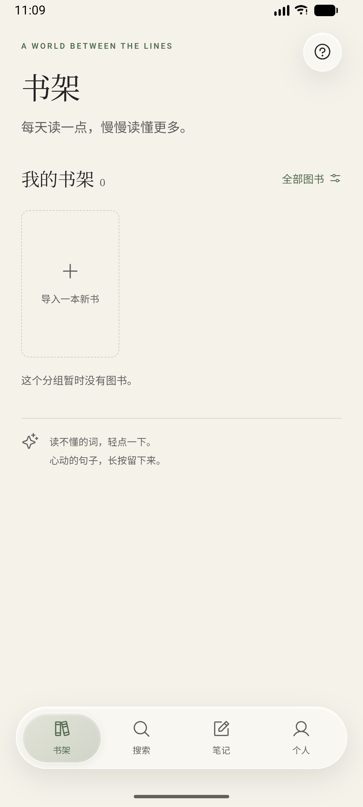
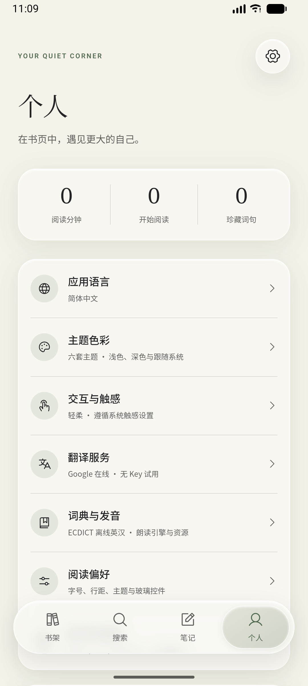
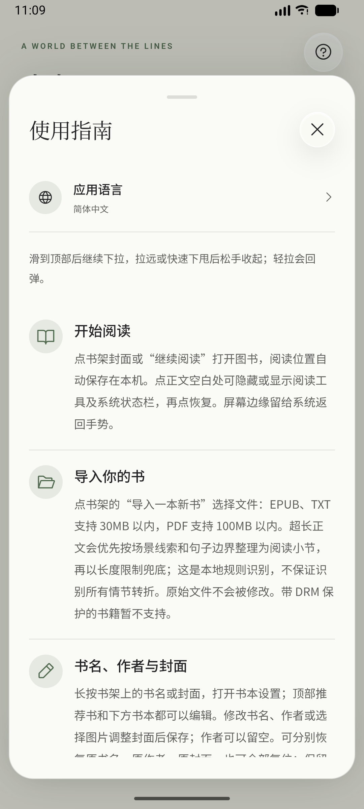

# 译读 YiDu｜安卓外文阅读与翻译

译读是一款 Android 阅读应用，将电子书阅读、点词查释义、翻译和笔记放在一起，帮助你边读边理解。

**版本：0.5.57** · Android 应用 · 支持简体中文、繁体中文和英文界面

## 下载

- **[下载安卓安装包 APK](https://github.com/v6rjhrny8d-hue/yidu-transread/raw/refs/heads/main/releases/YiDu-0.5.57.apk)**
- **[下载 0.5.57 原始源码 ZIP](https://github.com/v6rjhrny8d-hue/yidu-transread/raw/refs/heads/main/releases/TransRead-0.5.57-source.zip)**

下载后在 Android 手机上打开安装。覆盖更新需要安装包与现有版本签名一致；请先备份重要图书和笔记。

## 应用截图

以下为 0.5.57 在 Android 模拟器中的真实运行截图，显示首次使用状态。

| 书架 | 个人设置 | 使用指南 |
| --- | --- | --- |
|  |  |  |

## 功能

- 导入 EPUB、TXT 和 PDF 阅读；保存阅读位置，整理书架。
- 点词查释义、朗读，使用笔记保存词句；支持本地词典和发音资源导入。
- 支持在线翻译和自定义翻译服务，具体可用性取决于网络及所选服务。
- 六套主题、深浅色模式，以及字体、行距等阅读偏好。
- 支持图书和笔记备份恢复。资源包要求见 [资源说明](RESOURCE-PACKS.md)。

EPUB、TXT 文件上限为 30 MB，PDF 上限为 100 MB；不支持带 DRM 保护的书籍。部分词典和语音资源需自行导入，实际兼容性取决于资源格式。

## 开发

项目由 Web 界面和 Android 原生组件组成。开发与构建细节见 [开发状态](DEVELOPMENT-STATE.md)、[历史说明](docs/README-HISTORY.md) 和 [资源包说明](RESOURCE-PACKS.md)。源码包不含原签名密钥，重新签名的版本不能直接覆盖原签名应用。

APK SHA-256：`8d4a8db3cc4cf922b44bbed10b08a1eddd4314eb62df8f04a50379ba503be865`

本页基于提供的 0.5.57 文件；未确认其是否为最新版本。模拟器截图不代表已完成真机、翻译服务或商业词典验收。
